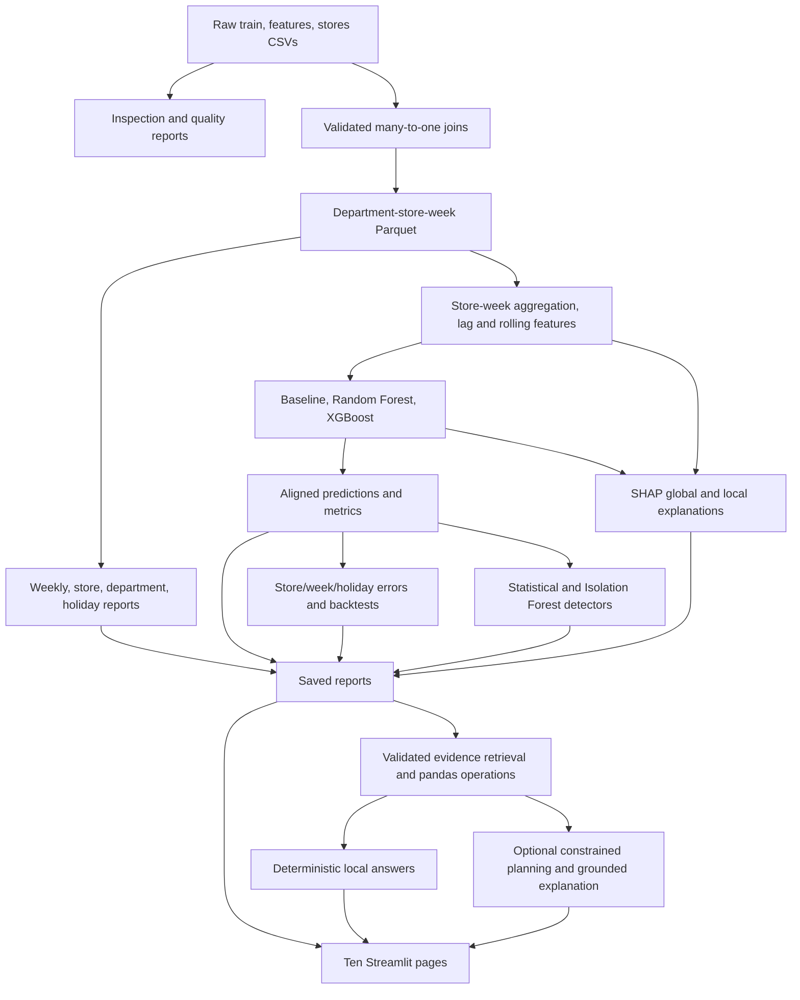

# Architecture and data flow

## What the application does

RetailIQ AI is an offline retail decision-support application built around the Walmart weekly-sales dataset. It combines reproducible batch experiments with a read-only interactive dashboard and an optional Gemini assistant. The data has 421,570 department-store-week sales records, 45 stores, and 143 calendar weeks from February 2010 to October 2012. Forecasting deliberately changes grain to store-week totals.

## Architectural boundaries

The implementation is a feature-based modular monolith: one installable Python package and one Streamlit process, with separate batch execution. Features own their calculations and report generation. Shared configuration, logging, and CSV access stay small. Dashboard pages depend on saved artifacts and assistant services; the assistant's evidence access does not depend on Streamlit.

## Main components

| Module | Responsibility and important contract |
|---|---|
| `data/ingestion.py`, `inspection.py`, `quality/` | Read the three CSV sources; report missingness, duplicate keys, relationships and raw anomalies. |
| `data/transformation.py` | Join sales to store-week features and store metadata with `many_to_one` validation; reject missing/duplicate keys, missing relationships and conflicting holidays. Preserve row order and sales values. |
| `analytics/` | Aggregate sales trends, stores/departments and holiday comparisons. Holiday comparisons use store-week observations rather than unequal counts of department records. |
| `forecasting/` | Aggregate store-week targets; create lags 1, 2 and 4 plus shifted four-week mean/std; compare baseline, RF and XGBoost on common keys. Reject gaps that would invalidate weekly lag semantics. |
| `reliability/` | Analyze signed/absolute errors by store, week and holiday; normalize with WAPE/bias; run three expanding historical folds before the final test interval. |
| `anomalies/` | Calibrate residual z-score threshold and Isolation Forest on validation observations, score held-out test observations, and reconcile detector overlap into an investigation queue. |
| `explainability/` | Load the saved trusted model; match test features/predictions; calculate TreeExplainer contributions and verify baseline plus contributions reconstructs predictions. |
| `assistant/` | Validate supported scope, choose allowlisted analytics operations, calculate in pandas, return evidence with filenames, and optionally request Gemini explanations. |
| `dashboard/` | Ten destinations, all under `dashboard/pages/`: Overview, Dataset Overview, Business Analytics, Sales Explorer, Sales Forecasting, Forecast Reliability, Anomaly Investigation, Explainable AI, Business Assistant and Project Overview. Every page exposes `render()` and uses shared navigation/configuration. |
| `config.py`, `reports.py`, `pipeline.py` | Resolve application paths independently of current working directory, validate settings, confine report reads, orchestrate 22 ordered research steps and fail fast. |

## Forecast evaluation

Sales are aggregated from departments to 6,435 store-week observations. Baseline shift removes the initial week; unique dates define approximately 70/15/15 train/validation/test intervals. Models use the baseline's exact split labels. The four-week feature warmup leaves 6,255 model rows; comparison intersects `(Store, Date, Split)` keys so all three models use equal cohorts (4,320 train, 945 validation, 990 test).

Lag and rolling features exclude the target week. Calendar features are known in advance. Evaluation is sequential one-week-ahead with previous actuals available, including earlier actuals within an evaluation interval. Random time splits and recursive multiweek forecasting would have different assumptions. Model choice uses validation MAE; the final test is reserved for reporting. Backtesting evaluates three eight-week windows before June 1, 2012.

## Assistant request flow

1. Validate text length and supported dataset/metric/time scope.
2. Parse common rankings and comparisons locally. For eligible unfamiliar wording only, ask Gemini for an allowlisted JSON plan.
3. Validate exact fields, operations, requested count, direction, entity and store IDs. No generated code or SQL is executed.
4. Execute pandas calculations or retrieve selected saved forecasting, reliability, anomaly or SHAP evidence.
5. Format custom sales calculations locally. For other supported topics, optionally ask Gemini to explain supplied evidence.
6. Reject generated numbers absent from evidence/question (allowing minor rounding); preserve evidence if generation is unavailable or rejected.
7. Render answer, provenance, metrics, charts and original records; keep conversation history in Streamlit session state.

The numeric guard validates numeric membership, not semantic relationships or every factual statement. The assistant supports a bounded analytics vocabulary; it cannot answer arbitrary SQL questions, profit, unsupported periods or live-store questions.

## Storage and runtime

CSV/JSON reports and Parquet are the implemented storage layer. There is no SQLite integration despite the original planning document proposing one. `data/raw`, generated datasets, `reports/` and `models/` are ignored by Git. joblib model files must come from trusted project runs. Gemini is the only external service; core analytics are local. API credentials never appear in configuration representations or provider-error messages.

Streamlit caching is confined to the presentation layer and keyed by report path, modification time and size. No page trains a model. The CLI imports stage modules lazily, logs stage transitions, and stops on failure. Runs overwrite stage artifacts; run isolation is provided through the process setting `RETAILIQ_HOME`.

## Engineering decisions and limits

- Preserve legitimate negative sales rather than blindly deleting unusual values.
- Preserve missing markdowns with explicit indicators rather than assuming unknown promotions equal zero.
- Verify merge cardinality and original totals to prevent silent join inflation.
- Compare models against a transparent baseline and identical chronological cohorts.
- Separate calibration from final anomaly scoring; flags do not prove fraud or incidents.
- Reconstruct SHAP predictions to verify explanation/model alignment; explanations are not causal.
- Keep LLM output outside the numerical calculation path, with constrained planning and evidence provenance.
- Use packaging and feature boundaries instead of import-path manipulation or HTTP layers the application does not need.

Production service deployment would additionally require data/artifact versioning, reproducible locked environments, scheduling, external authentication if exposed, monitoring, concurrency controls and atomic publication of consistent report sets. These are documented future concerns, not implemented features.
